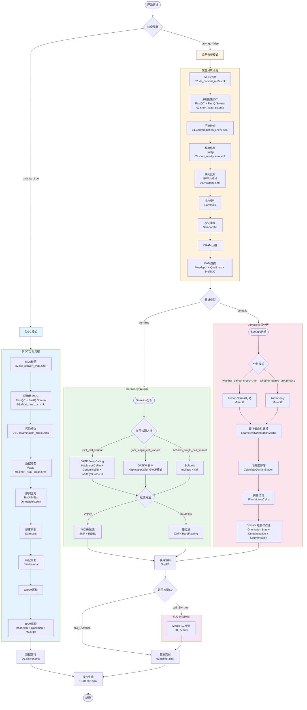

# WGSFlow v0.0.1 - 高效模块化全基因组分析流程

**WGSFlow** 是一款基于 Snakemake 开发的、面向工业级应用的 WGS 自动化分析流程。它遵循 GATK Best Practices 和群体遗传学标准，旨在提供高度灵活、可扩展且透明的基因组变异检测方案。

> ⚠️ **注意**：当前版本 (v0.0.1) 仅支持 **WGS (全基因组测序)** 分析。WES (全外显子组测序) 分析流程正在规划中，将在后续大版本中推出。

## 🚀 今日更新摘要 (2026-03-05)

### 1. 变异检测模块化重构 (Germline Variant Calling)
- **多引擎支持**：支持通过 `config.yaml` 动态切换 Bcftools、GATK Single-Sample (GVCF 模式) 和 GATK Joint-Calling。
- **动态过滤算法**：为 Bcftools 引入了基于样本量的动态 DP 阈值（`num_samples * 5`）及 MAF/Missingness 自动切换逻辑。

### 2. Somatic（体细胞）分析链条全线贯通
- **Mutect2 配对分析**：实现了从 `Tumor-Normal` 配对调用到多重过滤（Orientation Bias, Contamination, Segmentation）的完整闭环。
- **自动化交付集成**：**[NEW]** Somatic 模块已正式接入 `DataDeliver` 调度系统。流程会自动解析 `contrasts.csv` 中的配对关系，并自动生成以下核心交付物：
    - `04.filter_variant/somatic/{contrast}.somatic_filtered.vcf.gz` (最终高置信突变集)
    - `04.filter_variant/somatic/{contrast}.somatic_filtered.annotation.csv/html` (SnpEff 功能注释)
    - `03.call_variant/somatic/{contrast}.contamination.table` (交叉污染度评估报告)

### 3. 工程架构优化 (Workflow Management)
- **DataDeliver 调度系统**：采用“模块化定义 + 动态拼接”模式，彻底解耦文件路径定义（`datadeliver.py`）与逻辑调度（`common.py`）。
- **自动化路径映射**：`id_convert.py` 现在支持自动构建 BWA-MEM 规范路径，并精准匹配瘤旁配对样本。
- **规范化监控**：所有规则均对齐了 `06.mapping.smk` 标准格式，包含 `message`、`benchmark` 及 `resources` 资源隔离。

## 🛠️ 核心架构

```text
WGSFlow/
├── rules/
│   ├── 06.mapping.smk       # 比对与质控 (BWA-MEM, MarkDup, Qualimap)
│   ├── 07.germline.smk      # Germline 调度器 (支持 Bcf/GATK 动态加载)
│   ├── 07.somatic.smk       # Somatic 流程 (Mutect2 完整过滤链)
│   ├── 08.SV.smk            # 结构变异检测 (Manta)
│   └── sub_rules/           # 具体算法实现模块 (VQSR, HardFilter 等)
├── rules/utils/
│   ├── common.py            # DataDeliver 总调度逻辑 (分析模式切换)
│   ├── datadeliver.py       # 模块化文件定义库 (各模块产物定义)
│   └── id_convert.py        # 样本表与对比表解析引擎
└── config/
    └── config.yaml          # 流程控制核心配置文件
```

## 📊 分析流程图



## ⚙️ 配置项说明

| 配置项 | 类型 | 说明 | 可选值 |
|--------|------|------|--------|
| `only_qc` | boolean | 是否仅运行QC分析 | `true`/`false` |
| `library_type` | string | 文库类型 **(WES暂未实现)** | `WGS`/`WES` |
| `analysis_type` | string | 分析类型 | `germline`/`somatic` |
| `whether_paired_group` | boolean | 是否配对分析（仅somatic） | `true`/`false` |
| `germline_call_variant_type` | array | 生殖细胞变异检测方法 | `joint_call_variant`, `gatk_single_call_variant`, `bcftools_single_call_variant` |
| `call_SV` | boolean | 是否检测结构变异 | `true`/`false` |

## ⚠️ 注意事项与已知限制

1. **模块互斥性检查缺失**：没有防止同时选择germline和somatic分析的机制
2. **SV检测独立性**：SV检测独立于变异检测，可能导致逻辑混淆
3. **WES分析暂未实现**：虽然配置文件中有`library_type`选项，但WES专用逻辑（如目标区域富集、覆盖度分析等）尚未开发，将在后续版本中推出

## 📋 快速开始

### 1. 配置分析模式
在 `config.yaml` 中指定你的分析目标：

```yaml
# 分析类型: germline 或 somatic
analysis_type: "somatic"

# 若为 somatic，需指定是否为配对模式
whether_paired_group: True
```

### 2. 准备配对信息 (仅限 Somatic)
创建 `contrasts.csv` 定义 Tumor/Normal 关系（表头需为 Tumor, Normal）：
```csv
Tumor,Normal
Patient01_Tumor,Patient01_Normal
Patient02_Tumor,Patient02_Normal
```

### 3. 运行流程
```bash
# 推荐先进行干跑测试 (Dry run)
snakemake -s snakefile -n

# 正式运行
snakemake -s snakefile --use-conda --cores 32
```

## 🌟 下个版本规划 (Roadmap)

### v0.0.2 - 植物研究优化与流程加固
- [ ] **VQSR过滤基因组版本检查**：确保植物基因组不会错误尝试运行VQSR
- [ ] **植物专用变异过滤策略**：优化Hard Filtering参数，开发植物专用过滤阈值
- [ ] **结构变异检测增强**：添加Smoove或GRIDSS等适合植物的SV检测工具
- [ ] **倍性处理优化**：扩展支持更多植物倍性，在工具中更好地利用倍性信息
- [ ] **配置验证增强**：添加严格的配置互斥性检查，防止植物基因组加载人/小鼠专用资源
- [ ] **植物特异性注释**：考虑添加PlantAnnot等植物专用注释工具
- [ ] **测试数据集**：添加小型植物测试数据集用于流程验证
- [ ] **文档更新**：明确区分植物模式和人/小鼠模式的不同功能

### v0.1.0 - WES 分析功能 (人/小鼠专用)
- [ ] 实现 WES (全外显子组测序) 分析流程
- [ ] 支持目标区域 BED 文件处理
- [ ] 添加 WES 专用覆盖度统计分析
- [ ] 实现靶标区域富集效率评估

### v0.2.0 - 人/小鼠专用扩展功能
- [ ] **CNV分析**：整合ASCAT、CNVkit、Control-FREEC等拷贝数变异检测工具
- [ ] **MSI检测**：添加MSIsensor-pro微卫星不稳定检测
- [ ] **更多变异检测工具**：整合FreeBayes、Strelka2、DeepVariant等

### 未来规划
- [ ] 完善基于 Quarto 的变异检测可视化报告

---

**WGSFlow** - *让每一组碱基序列都清晰可见。*
